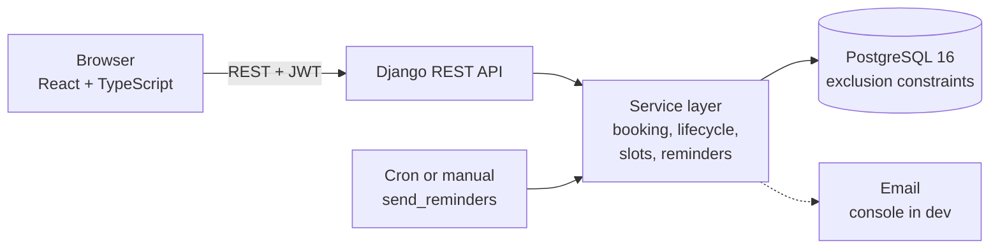

# SlotKeeper


**Appointment booking for small clinics and tutors, built around one guarantee: a provider can never be double-booked, even when two people click the same slot at the same instant.**

Django REST API · PostgreSQL · React + TypeScript

<!--
Add screenshots here once you have them (save the files in docs/screenshots/):

<p align="center">
  
  
  
</p>
-->

---

## Contents

- [The problem](#the-problem)
- [Features](#features)
- [How it works](#how-it-works)
- [Architecture](#architecture)
- [Tech stack](#tech-stack)
- [Getting started](#getting-started)
- [Running the tests](#running-the-tests)
- [API overview](#api-overview)
- [Configuration](#configuration)
- [Project structure](#project-structure)
- [Known limitations](#known-limitations)

## The problem

Small practices book appointments over WhatsApp and paper diaries. Two people get promised the same slot, reminders never go out, and no-shows cost real money. SlotKeeper replaces that with a booking system where the rules are enforced by the database, not by hoping the application checks in time.

## Features

**Clients**
- Self-register, browse providers (filter by specialty) and see open slots for a chosen day
- Book, reschedule and cancel their own appointments
- See every time in the **provider's** time zone, clearly labelled

**Providers**
- Set weekly working hours (for example 09:00–12:00 and 14:00–17:00) and one-off time off
- Configure visit length, how far ahead clients can book, minimum notice and the cancellation cut-off
- Reschedule or cancel appointments, mark them completed or no-show

**Admins**
- Create providers and manage everything through the Django admin

**Platform**
- JWT authentication with short-lived access tokens and refresh tokens
- Email reminders and cancellation notices (printed to the console in development)
- Interactive OpenAPI documentation

## How it works

### 1. The double-booking guarantee

Checking "is this slot free?" in application code is not enough: two requests can both pass the check before either one saves. SlotKeeper enforces the rule inside PostgreSQL with **exclusion constraints** on the appointment's time range:

- one for `(provider, time range)`, so a provider cannot have two overlapping booked appointments
- one for `(client, time range)`, so a client cannot be in two places at once

If two requests race for the same slot, the database lets exactly one commit and rejects the other, whatever the application does. The API turns that rejection into a clean `409 Conflict`.

On top of the constraints, booking takes a **per-provider row lock** and retries automatically if PostgreSQL reports a deadlock. Locks are always taken in the same order (appointment first, then provider), so booking and rescheduling cannot deadlock each other.

The guarantee is tested, not assumed. The concurrency tests fire simultaneous requests from separate threads and assert that exactly one wins, over many rounds, for booking, cancellation and the complete/no-show race. The test suite was also checked by deliberately breaking the code (removing a lock, weakening a rule) to confirm the tests fail when they should.

### 2. Time zones

Instants are stored in UTC. A provider's working hours are stored as wall-clock times in the provider's own IANA time zone (for example `Europe/London`), and converted to real instants when slots are generated. That keeps "09:00" meaning 09:00 across daylight-saving changes. The API rejects timestamps without an offset instead of guessing, and the frontend always displays the provider's zone.

### 3. Appointment lifecycle

```
booked ──► completed
   │  ╲──► no_show
   ╰────► cancelled
```

| Rule | Default | Configurable per provider |
|---|---|---|
| Visit length | 30 min | yes |
| Booking window | 30 days ahead | yes |
| Minimum notice | 2 hours | yes |
| Client cancel / reschedule cut-off | 4 hours before the start | yes |

Providers and admins are not limited by the cut-off. Completed, no-show and cancelled are final. Rescheduling moves the same appointment in place (same id, same history) and resets its reminder.

### 4. Security and API design

- Self-registration **always creates a client**. The role is never read from request data.
- Permissions are enforced in the queryset: asking for someone else's appointment returns `404`, not `403`, so ids cannot be probed.
- Errors are consistent: every error body carries a machine-readable `code` (`slot_unavailable`, `client_conflict`, `invalid_transition`, `deadline_passed`, ...).
- Requests are throttled (60/min anonymous, 300/min authenticated).
- The frontend keeps the access token in memory and the refresh token in `localStorage`. This is a documented trade-off: it survives a page reload but is exposed to XSS, which httpOnly cookies would avoid.
- Reminder workers use `SELECT ... FOR UPDATE SKIP LOCKED`, so several can run in parallel without sending anything twice (at-least-once delivery).

## Architecture



Views stay thin: they validate input and translate domain errors into HTTP responses. The rules live in the service layer (`apps/scheduling/services/`), where they can be tested directly against a real database.

## Tech stack

| Layer | Tools |
|---|---|
| Backend | Python, Django 5, Django REST Framework, SimpleJWT, django-filter, drf-spectacular |
| Database | PostgreSQL 16 (required: exclusion constraints and `btree_gist`) |
| Frontend | React 19, TypeScript (strict), Vite, React Router, TanStack Query |
| Testing | pytest, pytest-django, factory-boy · Vitest, Testing Library · Playwright |
| Tooling | Docker Compose (local database), GitHub Actions CI, ruff |

## Getting started

### Prerequisites

- Python 3.12 or newer
- Node.js 22 or newer
- Docker (for PostgreSQL), or your own PostgreSQL 16 install

### 1. Clone and configure

```bash
git clone https://github.com/amina-s232/slotkeeper.git
cd slotkeeper
cp .env.example .env        # Windows PowerShell: copy .env.example .env
```

Open `.env` and set `DJANGO_SECRET_KEY`. Generate one with:

```bash
python -c "from django.core.management.utils import get_random_secret_key as g; print(g())"
```

> If the generated key contains a `$` and you use Docker Compose, wrap the value in single quotes: `DJANGO_SECRET_KEY='...'`.

### 2. Start the database

```bash
docker compose up -d db
```

PostgreSQL listens on `localhost:5432`. If that port is already taken (for example by a local PostgreSQL install), set `POSTGRES_PORT=5433` in `.env` and run the command again.

### 3. Run the backend

```bash
python -m venv .venv
source .venv/bin/activate          # Windows PowerShell: .venv\Scripts\Activate.ps1
pip install -r backend/requirements/dev.txt

cd backend
python manage.py migrate
python manage.py seed_demo         # demo providers, clients and bookings (development only)
python manage.py runserver
```

The API is now at <http://localhost:8000>, with interactive docs at <http://localhost:8000/api/docs/>.

### 4. Run the frontend

In a second terminal:

```bash
cd frontend
npm install
npm run dev
```

Open <http://localhost:5173>. The dev server proxies `/api` to the backend at `http://127.0.0.1:8000`; set `BACKEND_URL` if yours runs elsewhere.

### Demo accounts

`seed_demo` creates these accounts (password for all: `demo-pass-123`):

| Role | Email |
|---|---|
| Client | `asha@demo.test`, `ravi@demo.test`, `meera@demo.test` |
| Provider | `dr.rao@demo.test` (Asia/Kolkata), `dr.hughes@demo.test` (Europe/London) |
| Admin | `admin@demo.test` |

The admin site is at <http://localhost:8000/django-admin/>. Re-run `python manage.py seed_demo --reset` to restore the demo bookings. These accounts have a publicly known password, so the command refuses to run unless `DEBUG` is on.

### Creating a real provider

Self-registration only creates clients. To add a provider, sign in to the Django admin, create a user with role **provider**, then create a **Provider** record linked to that user (display name and time zone). They can then sign in normally and set their hours on the Schedule page.

### Email reminders

```bash
python manage.py send_reminders --hours 24
```

Emails every booked appointment starting within the next 24 hours, once. Safe to run from several workers at once. In development, emails are printed to the console.

## Running the tests

Backend (needs the database running):

```bash
cd backend
python -m pytest -q          # 190+ tests, around two minutes (the concurrency tests take longest)
ruff check .
ruff format --check .
```

Frontend:

```bash
cd frontend
npm run typecheck
npm test                     # unit and component tests
npm run build
```

End-to-end (a real browser against the running app; needs seeded data and both servers running):

```bash
cd frontend
npx playwright install chromium     # once
npm run e2e
```

The script books, reschedules and cancels through the real UI, with the browser deliberately set to a different time zone from the provider to catch any time that follows the browser instead. It changes the demo data, so run `python manage.py seed_demo --reset` before running it again.

## API overview

Interactive documentation: `/api/docs/` · OpenAPI schema: `/api/schema/` · Health check: `GET /api/health/`

| Method | Path | Who | Description |
|---|---|---|---|
| POST | `/api/auth/register/` | anyone | Create a client account |
| POST | `/api/auth/token/` | anyone | Log in, receive access and refresh tokens |
| POST | `/api/auth/token/refresh/` | anyone | Exchange a refresh token for a new access token |
| GET, PATCH | `/api/auth/me/` | signed in | View or edit your own profile |
| GET | `/api/providers/` | signed in | Provider directory (`?specialty=`) |
| GET | `/api/providers/{id}/` | signed in | One provider |
| GET | `/api/providers/{id}/slots/?date=YYYY-MM-DD` | signed in | Bookable slots for a day |
| GET, PATCH | `/api/me/provider/` | provider | Own profile and booking rules |
| GET, POST, PATCH, DELETE | `/api/me/availability-rules/` | provider | Weekly working hours |
| GET, POST, DELETE | `/api/me/time-off/` | provider | One-off time off |
| GET | `/api/appointments/` | signed in | Your appointments (`?starts_after=`, `?starts_before=`) |
| POST | `/api/appointments/` | client | Book an appointment |
| POST | `/api/appointments/{id}/cancel/` | participant | Cancel |
| POST | `/api/appointments/{id}/reschedule/` | participant | Move to another slot of the same provider |
| POST | `/api/appointments/{id}/complete/` | provider, admin | Mark completed |
| POST | `/api/appointments/{id}/no-show/` | provider, admin | Mark as no-show |

**Errors.** Every error response includes a `code`. Typical statuses: `400` invalid input or a time the provider does not offer, `401` not signed in, `404` not found (or not yours), `409` slot already taken, client already booked, invalid state change, or past the cancellation cut-off.

Example, booking a slot:

```bash
curl -X POST http://localhost:8000/api/appointments/ \
  -H "Authorization: Bearer <access token>" \
  -H "Content-Type: application/json" \
  -d '{"provider": 1, "starts_at": "2030-01-07T09:00:00+05:30", "notes": "First visit"}'
```

## Configuration

Settings are read from environment variables, or from `.env` in the project root. `.env.example` lists them.

| Variable | Default | Purpose |
|---|---|---|
| `DJANGO_SECRET_KEY` | none, required | Django secret key |
| `DJANGO_ALLOWED_HOSTS` | `localhost,127.0.0.1` | Comma-separated allowed hosts |
| `CORS_ALLOWED_ORIGINS` | `http://localhost:5173` | Origins allowed to call the API from a browser |
| `POSTGRES_DB`, `POSTGRES_USER`, `POSTGRES_PASSWORD` | `slotkeeper` | Database credentials |
| `POSTGRES_HOST`, `POSTGRES_PORT` | `localhost`, `5432` | Database address |
| `EMAIL_BACKEND` | console backend | Where emails go (prints to the terminal by default) |
| `DEFAULT_FROM_EMAIL` | `SlotKeeper <noreply@slotkeeper.local>` | Sender address |
| `BACKEND_URL` | `http://127.0.0.1:8000` | Frontend dev proxy target (frontend environment) |

## Project structure

```
slotkeeper/
├── backend/
│   ├── config/                  # settings (base, dev, prod), URLs, error handler, health check
│   ├── apps/
│   │   ├── accounts/            # custom email-login user, roles, JWT auth endpoints
│   │   └── scheduling/
│   │       ├── models.py        # Provider, AvailabilityRule, TimeOff, Appointment (+ constraints)
│   │       ├── services/        # booking, lifecycle, slots, reminders, notifications
│   │       ├── views.py         # thin API layer
│   │       └── management/      # seed_demo, send_reminders
│   └── tests/                   # unit, API and concurrency tests
├── frontend/
│   ├── src/
│   │   ├── api/                 # typed fetch client, token refresh, endpoint functions
│   │   ├── auth/                # auth context and role-based routing
│   │   ├── components/          # reusable UI
│   │   ├── pages/               # screens
│   │   └── lib/time.ts          # time-zone and daylight-saving logic
│   └── e2e/smoke.cjs            # browser end-to-end test
├── docs/SPEC.md                 # original build specification
├── docker-compose.yml           # local PostgreSQL
└── .github/workflows/ci.yml     # lint, migrations check, tests
```

## Known limitations

These are deliberate scope limits, not oversights.

- **Single tenant.** One deployment serves one clinic or tutoring group.
- **No payments and email only.** No SMS or WhatsApp.
- **Reminders need a scheduler.** `send_reminders` works, but nothing runs it on a timer; schedule it with cron or a task runner.
- **Providers are created by an admin** through the Django admin; there is no in-app invitation flow.
- **Changing a provider's time zone** keeps existing bookings (they are fixed instants) but moves future working hours. There is no warning in the UI.
- **Not deployed yet.** The project runs locally; deployment is planned.

## License

Add a license of your choice (for example MIT) before sharing the repository publicly.
